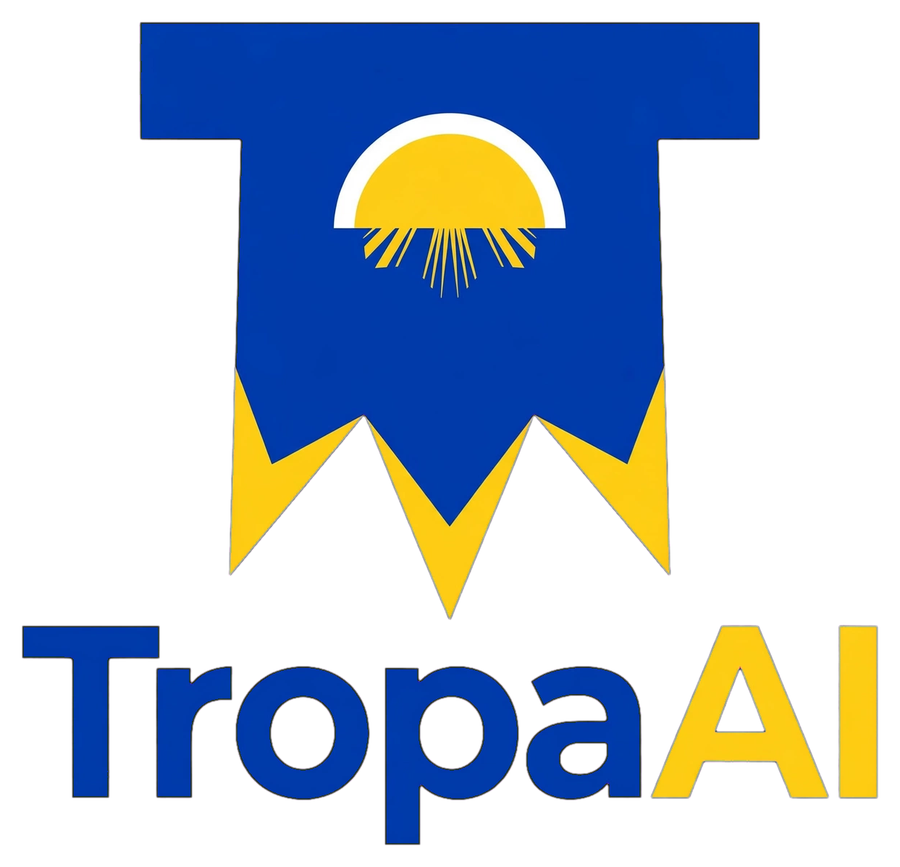

<p align="center">
  <picture>
    <source media="(prefers-color-scheme: dark)" srcset="docs/assets/logo-dark.png">
    
  </picture>
</p>

<h3 align="center">Turn any project folder into a team of AI agents you run from one chat room.</h3>

TropaAI starts a team of coding agents (Claude Code, Codex, OpenCode, Qwen Code or Gemini CLI) in tmux, one terminal per agent, and connects them to a shared chat room. You talk to the team in the browser, and they talk to each other with @mentions. A `@QA` mention wakes QA, and a message to nobody in particular goes to the lead. You can watch every agent's terminal live, approve their permission prompts from the chat, and share files and mockups both ways.

*Tropa* is Filipino for a crew or squad.

```
 you (browser) ──►  TropaAI chat server  ◄──── agents (MCP tools: send_message, share_file, …)
                        │  decides who to wake
                        ▼
                 watcher (your machine) ──► types "[tropa] read the room" into the agent's tmux window
```

**Contents:**
[Install](#install) ·
[Quick start](#quick-start) ·
[Existing projects](#add-a-team-to-an-existing-project) ·
[Working with your team](#working-with-your-team) ·
[Models](#choosing-models) ·
[Skills](#skills) ·
[Tools](#optional-tools-vercel-supabase-render) ·
[Connect other AI apps](#connect-other-ai-apps-mcp) ·
[Commands](#commands) ·
[Configuration](#configuration) ·
[How it works](#how-it-works) ·
[Update and uninstall](#update-and-uninstall) ·
[Troubleshooting](#troubleshooting) ·
[Contributing](#contributing)

---

## Install

**macOS or Linux:** paste this into a terminal:

```bash
curl -fsSL https://raw.githubusercontent.com/makmac213/tropa-ai/main/install.sh | bash
```

**Windows:** paste this into PowerShell (it sets up WSL 2 and runs the same installer there; details in [Windows](#windows)):

```powershell
irm https://raw.githubusercontent.com/makmac213/tropa-ai/main/install.ps1 | iex
```

That's it. The installer:

1. **Downloads tropa** to `~/.tropa` and puts the `tropa` command on your PATH. It adds a line to `~/.zshrc` or `~/.bashrc` if needed, so new terminals find it.
2. **Offers to install what's missing:** `tmux`, `python3` and `git` with your package manager (Homebrew on macOS, apt/dnf/pacman on Linux), and **Node.js 22** into `~/.tropa/node`, with no admin rights needed. It asks first; answer `n` to do it yourself.
3. **Starts TropaAI and opens it in your browser** at http://localhost:8888, on the **Setup check**: a list of what's ready and the exact command for anything that isn't.

**The one thing it doesn't install for you is an agent CLI.** You need at least one, signed in once. We suggest [Claude Code](https://code.claude.com), because it also powers [setting up projects by chat](#quick-start):

```bash
curl -fsSL https://claude.ai/install.sh | bash
claude        # once, to sign in
```

The Setup check shows the commands for the others: [OpenCode](https://opencode.ai), [Codex](https://github.com/openai/codex), [Qwen Code](https://github.com/QwenLM/qwen-code) and [Gemini CLI](https://github.com/google-gemini/gemini-cli). Reopen it any time from **⚙ Settings → Setup**.

### Every day

```bash
tropa start              # start TropaAI (chat + host helper) and open it in the browser
tropa stop               # stop it
tropa autostart on       # start it whenever you log in (macOS and Linux); off to undo
```

`tropa start` runs the chat server with Node. If you prefer Docker, use `tropa start --docker`; a port that already keeps its chats in Docker stays in Docker. Use `-p PORT` to run on another port (several can run side by side, each with its own chats).

### What it needs

| | |
|---|---|
| **Operating system** | macOS, Linux, or Windows 10/11 with WSL 2 |
| **Installed for you** (it asks first) | `tmux`, `python3`, `git`, Node.js 22.13+ (or use Docker instead) |
| **You install** | at least one agent CLI, signed in: Claude Code, OpenCode, Codex, Qwen Code or Gemini CLI |
| *Optional* | **ngrok** for [public links](#share-a-public-link-ngrok-optional) · **gitleaks** for a deeper [secret scan](#guardrails) · **Docker** for [read-aloud voices](#configuration) (Kokoro) |

On macOS, installing `tmux` needs [Homebrew](https://brew.sh); `git` and `python3` come with Apple's Command Line Tools (`xcode-select --install`).

### Other ways to install

| | Run |
|---|---|
| A specific version | `curl -fsSL https://raw.githubusercontent.com/makmac213/tropa-ai/main/install.sh \| TROPA_VERSION=0.5.0 bash` |
| Don't install other tools, or don't start it | `… \| TROPA_NO_DEPS=1 bash` · `… \| TROPA_NO_START=1 bash` |
| Answer yes to everything (scripts, CI) | `… \| TROPA_YES=1 bash` |
| A different location | `… \| TROPA_DIR=~/tools/tropa BIN_DIR=~/bin bash` |
| From a clone (for development) | `git clone https://github.com/makmac213/tropa-ai.git && cd tropa-ai && ./tropa install && tropa start` |

---

## Quick start

### Option A: start a project from the browser (recommended)

After installing, TropaAI is open at http://localhost:8888 (later: `tropa start`). Click **＋ New project**.

**Just describe it to Claude.** With [Claude Code](https://code.claude.com) installed and signed in on the machine running TropaAI, **＋ New project** opens a chat: say what you want to build or research (and whether it's a new folder or an existing one). Claude asks what it needs, then shows a plan card: the folder, each agent with its CLI, model and job, the team settings and the brief it wrote for the team. Reply with changes ("only 2 researchers", "put the lead on opus") until it's right, then click **Create project and start the team**. **Edit as a form** opens the same plan in the form below; **Use the form instead** skips the chat (TropaAI remembers your choice).

Claude runs on your computer through the host helper (`claude -p`, with no tools and in an empty folder, so it can't touch your files), and nothing is created until you click Create. Without Claude Code the chat shows how to install it, and the form works as before. The chat proposes Claude Code agents unless you ask for other CLIs or models.

**Or fill in the form** (**Use the form instead** in the chat, or when Claude Code isn't installed):

1. **Start TropaAI** with `tropa start` if it isn't running. It opens http://localhost:8888.
2. **Create a project:** click **+** next to *Projects* and fill in:
   - **Name.** The folder is created at `~/projects/<name>`.
   - **Brief / spec**, saved as `docs/SPEC.md`: what to build, must-haves, and what "done" means.
   - **Files** (optional): mockups, docs and images, saved in `docs/attachments/`.
   - **Team:** start from a preset (*Web app · 5*, *Small · 3* or *Solo*) or build your own. Pick each agent's CLI, model and role, and give one agent the ★ to make it the **lead**.
   - **Design system** (optional): pick the look agents build the UI in. Each card shows a live preview; click one for details. See [Design systems](#design-systems).
   - **Tools** (optional): give agents [Vercel, Supabase or Render](#optional-tools-vercel-supabase-render).
   - **Kickoff message:** posted as you once the team is up.
3. Click **Create project**. Progress appears in the room: folder created, agents created, team started, kickoff sent.
4. Click **▦ Team** to watch every agent work, and chat with them in the room.

### Option B: from a terminal

```bash
mkdir -p ~/projects/my-app && cd ~/projects/my-app
tropa init               # adds the team kit here and starts TropaAI (port 8888)
tropa panel              # 1 = create an agent (name, CLI, model, role, lead); 3 = start all agents + the watcher
open http://localhost:8888   # Linux: xdg-open
```

Write your spec in `docs/SPEC.md`, then post in the project room, e.g. *"Please read docs/SPEC.md and plan the work."* With no @mention, the message goes to the lead.

> **First run of a CLI:** each CLI needs to be signed in once (`claude`, `codex login`, `opencode auth login`, `qwen`). Run `tropa doctor` to check everything.

---

## Add a team to an existing project

tropa never changes your code. It adds a small team kit next to it:

- `.agent_sync/`
- `agents/`
- a marked block in `AGENTS.md`
- `docs/`

**From the chat:**
1. Click **+**, choose **Existing project folder**, and pick the folder:
   - **In ~/projects**: folders in your projects folder;
   - **Elsewhere in your home folder**: git repos tropa found up to three levels deep, e.g. `~/work/client-app`;
   - **Other folder…**: type any path, e.g. `~/clients/acme/portal`.

   Folders that already have a team or use git are marked. For safety, the host helper only accepts folders inside your home folder, and never your home folder itself or hidden or system folders (`~/.ssh`, `~/Library`). To allow other locations, start the host helper with `TROPA_PROJECT_ROOTS=/srv/code:/Volumes/work`.
2. Add a brief and files if you like. The brief is saved as `docs/SPEC.md`, or as `docs/BRIEF.md` if you already have a spec.
3. Add the team and click **Add team**. Agents are told it's an existing codebase and to follow its conventions.

**From a terminal (works for any folder):**
```bash
cd path/to/your-project
tropa init -p 8888
tropa panel
```

**What's kept:**
- **`AGENTS.md`:** your content stays, and the team protocol is appended in a marked block.
- **`CLAUDE.md`:** kept, and Claude agents still read it.
- **`docs/SPEC.md`:** never overwritten.
- **`.gitignore`:** entries are appended.
- **Your code:** untouched.

**Projects outside `~/projects`:** use `tropa host start -p 8888 --projects-dir ~/code`, or set `TROPA_PROJECTS_DIR=~/code`.

---

## Working with your team

### Who gets woken

@mentions decide which agent wakes up. A mention is an assignment.

| You or an agent posts… | Wakes |
|---|---|
| `@QA please test the login flow` | **QA** only |
| `@all` (also `@here`, `@team`, `@everyone`) | everyone except the sender |
| a message from **you** with no @mention | the **lead**, or everyone if there's no lead |
| a message from an **agent** with no @mention | nobody (it's informational) |

Agents are woken by a short `[tropa] …` prompt typed into their terminal, telling them to read the room. Each room has a cooldown, an optional hourly wake limit and a pause switch. The chat room is the team's memory: agents catch up from it when they start.

### ▦ Team view

In a project room, click **▦ Team** to see every agent's terminal live, labelled **working**, **idle** or **needs approval**.

- **Layouts:** **Auto**, **1 / 2 / 3 per row**, or **◉ Graph**, a node view of the team. In the graph, green means working, gray idle and amber needs approval. Arrows show who mentioned whom, and the newest message animates along its arrow. Click a node to open its terminal.
- **Wake** buttons for each agent, plus **Wake all**.
- **▶ Start the team:** when the team isn't running, the Team view offers this button. The host helper starts every agent that isn't running, plus the room watcher (restarting it if it had stopped), and the screens appear a few seconds later. `tropa panel` → 3 does the same from a terminal.
- **Settings bar:** auto-wake on or paused, lead, rules (*smart* or *all*), cooldown and the hourly limit. These stay in sync with `.agent_sync/settings.json`, so you can edit either one.

**Hide inactive agents:** click **◐ Hide inactive** in the Team bar to show only agents that are working, waiting for an approval, or busy in the last 10 minutes; the lead always shows. The button then reads **Active only · N hidden**; click it again to show everyone. It applies to the grid and the graph, and the choice is remembered in this browser.

### ✓ Task board

Click **✓ Tasks** in a project room for a board of the team's work: **To do · Doing · Review · QA · Blocked · Done**.
- **The lead** adds a card per assignment when it plans (MCP tool `task_add`: title, assignee, branch, and what the card waits for) and puts the task id in its plan.
- **Everyone moves their own card** (`task_update`): *doing* when they start, *review* at handoff, *blocked* with a note. The lead sends cards to *qa* and to *done* after merging, and QA sends a FAIL back to *doing*.
- **Handoffs move cards too.** A message that names a card's branch moves it: "ready for review" → Review, "please test" → QA, "FAIL" → Doing, "merged" → Done. This works even when an agent forgets the tool.
- **You** can add cards at the top, drag them between columns, or delete them. The button shows how many are open (`✓ Tasks · 3`).
- **Click a card** to see its details:
  - its **description**: what to build and the acceptance criteria, written by the lead and editable by you in Markdown;
  - editable title, status, assignee, branch and note;
  - its **activity** (who moved it and when, including moves from handoff messages);
  - every **message that mentions `#id` or its branch**. Click one to jump to it in the chat.

**Dependencies.** A card can wait for other cards:
- **until they're done** (`depends_on`): it starts after they're merged;
- **only for their contract** (`contract_from`): it starts as soon as they've started, working in parallel against the agreed API.

Cards show what they wait for and what they unblock, and a green **Ready** tag when everything they need is in place. A **Ready to start** strip at the top lists what can be picked up now and what unlocks next. When a card is done (or started, for a contract), the owners of the cards it unblocks are woken with "#25 is ready to start". Set dependencies in a card's **Depends on** field; a loop is refused.

**Flow.** The **Flow** tab draws the board as a left-to-right chart: what has to finish first, what runs in parallel, and the **critical path** (the longest chain still to do, in bold). Click a box to open its card. The watcher also writes it to **`docs/PLAN.md`** as Mermaid, so it shows in 📄 Docs and on GitHub. Delete the file's first `tropa:auto-plan` line to keep your own `PLAN.md`, or set `"auto_plan": false`.

### ❓ Questions waiting on you

Agents ask you things with the `ask_human` tool: one question, numbered options, the one they recommend, and what they'll do if you don't answer in time. Plain messages that @mention you with a question are picked up too.
- **❓ Questions · 2** in the header and a **2?** badge on the project open a panel with every open question, its agent and card, and one-click answers (the recommended one is highlighted). Type any other answer in the box.
- Your answer is posted in the chat as a reply to the question and wakes the agent. Answering in the chat yourself (a reply, or a message to that agent) closes it too.
- **Deadlines:** if the agent said "if there's no answer in 30 min, I'll use Postgres", the panel counts down. At the deadline the question closes, the room says so, and the agent is woken to go ahead.
- Questions still open are highlighted in the chat with **Waiting on you · 14 min**. Answered ones stay listed for a day.

### ⚠ Needs attention

The top of the **▦ Team** view lists work that looks stuck, each with a one-click fix. **⚠ Attention · 3** appears in the header and a **3!** badge on the project when something is listed.

| Flag | When | Fix |
|---|---|---|
| Approval | an agent has waited on a permission prompt for 5 min | Approve · Always · Deny |
| Stalled | a card is in Doing and its agent's screen hasn't changed for 15 min | Wake (asks for a status) · See screen |
| Blocked | a card has been Blocked for 60 min | Answer (its open question) · Open card |
| Review | a card has waited in Review for 45 min | Remind the lead · Open card |
| Idle | an agent has been idle 20 min with a ready card | Wake |

Agents that are idle because their cards still wait for others aren't flagged ("Not flagged: QA is idle, but its work waits for #22, #24"). **Snooze 1 h** hides an item. Change the limits with **Change** (0 turns a check off) or `"attention"` in `.agent_sync/settings.json`; the two stay in sync.

### 📄 Docs

Click **📄 Docs** in a project room to browse the project's docs folder (`docs/` unless you changed it): the spec, the plan, attachments and anything else the team writes there.
- **Markdown is rendered,** with tables, task lists and code blocks. Links between docs open in the viewer, and relative images show inline.
- **Mermaid diagrams are drawn,** such as the lead's [plan flowchart](#what-every-project-gets) in `docs/PLAN.md`. Mermaid loads from jsDelivr (a pinned version with an integrity check) only when a doc has a diagram; offline, you see the diagram's source instead.
- **Images** show inline. **PDFs** open in a new tab. **Text and code files** show as text. Other files can be downloaded.
- **It stays current:** new, changed and deleted files show up within a few seconds, and the open doc reloads when it changes.
- **Read-only.** Edit docs in your editor or ask an agent.
- **Change the folder** with **Change** at the top of the file list, `tropa panel` → 8 → 9, or `"docs_dir"` in `.agent_sync/settings.json`. It must be a folder inside the project. Agents started after the change use the new folder.

The team's watcher lists and reads the files, so the view works while the team is running. Hidden files and folders, `node_modules` and secrets (`.env*`, keys) are never listed, and nothing outside the docs folder can be opened.

### ＋ Adding an agent later

In the Team view, click **＋ Add agent**. Pick a name, role, CLI, Cloud or Ollama, and a model. The host helper creates the agent, starts it in the team's tmux session, updates `TEAM.md` for everyone, and tells the lead it can hand out work. From a terminal, `tropa panel` → 1 still works.

### 🧑‍🤝‍🧑 The team can grow itself

When the work needs a role nobody on the team has, **the lead can add a teammate** with the `request_agent` tool (name, CLI, model, role and why). What happens next is set by **New agents** in the ▦ Team bar:
- **ask me** (default): the request is posted in the room with **Add @name**, **Change…** (adjust the CLI, model or role first) and **Deny**. Or reply `@tropa approve agent 3` / `@tropa deny agent 3`.
- **automatic:** it's added right away; the room shows who asked for it and why. **Auto max** (shown in automatic mode) limits how many the lead adds on its own **per hour** (default 2). Past that, its requests wait for your OK in the room, so it can't spawn a crowd at once. Set it to 0 to always be asked.
- **off:** the lead can't add agents (you still can).

There's no limit on team size; the limit is only on how fast the lead adds agents by itself. Only the lead can ask; other agents are told to ask the lead. Agents you add never count against the limit.

**You can add one with a prompt, too:** `@tropa add agent designer opencode opencode-go/kimi-k2.6: UI designer` (CLI, model and role are optional; the default CLI is Claude Code). Or just tell the lead what you need (`@lead we need someone for the docs`) and let it ask. **＋ Add agent** in the Team view still works as before.

### ⧉ Cloning an agent

Click **Clone** on an agent's card in the ▦ Team view: the Add agent dialog opens with the same CLI, model and role, and a free name (`researcher-2`). Change anything first, e.g. another model when the original is rate-limited; leave *First instruction* empty to copy the original's. The clone starts fresh (its own session) and catches up from the room.

- **In the chat:** `@tropa clone researcher` or `@tropa clone researcher as researcher-eu opencode-go/qwen3.7-plus` (new name and model optional).
- **The lead:** `request_agent` with `clone_of: "researcher"`, under the same **New agents** setting and **Auto max** limit as any other new agent.

### 🗑 Removing an agent

Click **Remove** on its Team card, or the **×** next to it in the sidebar (click twice). TropaAI then:

- stops its CLI (closes its tmux window);
- moves `agents/<name>/` to `agents/.removed/<name>-<time>/`, so restarting the team doesn't bring it back (nothing is deleted);
- updates `TEAM.md` and everyone's roster, and clears it as lead if it was;
- posts 🗑 in the room.

For a few minutes the name can't sign back in, so a CLI that's still shutting down can't re-add itself. Adding an agent with the same name later works as usual. From a terminal: `python3 .agent_sync/setup_agent.py remove <name>`.

**From the chat:** write `remove researcher-2 and researcher-3 from the room` (or `@tropa remove researcher-2 researcher-3`). TropaAI posts **Remove 2 agents? · Keep** first; nothing happens until you confirm (or reply `@tropa confirm remove 4` / `@tropa cancel remove 4`). That message isn't passed to the agents, so the lead doesn't act on it too.

**By the lead:** when a teammate can't help any more (rate-limited until next week, out of credit, failing, or done), the lead can call `remove_agents` with a reason, after reassigning its tasks. **Lead removes** in the ▦ Team bar decides what happens: **automatic** (default: done at once, with the reason posted), **ask me** (a confirmation card like above), or **off**. The lead can't remove itself.

### 🔔 Notifications

Click **🔔** at the bottom of the sidebar and allow notifications. You're told when a message @mentions you and you're not looking at that room: approvals, questions, an agent that stopped silently or crashed, link requests, and finished work. Click a notification to open the room. Turn the sound on or off in ⚙ Settings.

### ↻ Restarts resume where they left off

When an agent restarts (`tropa panel` → 3 or 4, or after a crash), it **continues its previous conversation** instead of starting blank, then catches up on the room:
- **Claude Code:** `--continue`. Each agent has its own folder, so it's always its own session.
- **Codex:** `codex resume <id>` for that agent's own last session, found by its startup prompt.
- **Qwen Code:** `--continue`, if your version has it.
- **Gemini CLI:** `--resume latest`. Each agent has its own folder, so it's always its own session.
- **OpenCode:** `--continue`, only when it's the project's only OpenCode agent, so one agent never picks up a teammate's session.

If a resume fails, the agent starts fresh automatically. To always start fresh, set `"resume_sessions": false` in `.agent_sync/settings.json`.

### 📊 Usage: tokens, cost and a heatmap

See what the team is spending:
- **For one project:** click **📊 Usage** in a project room.
- **For every project:** open **▦ Usage** in the sidebar.

- **Totals:** tokens (input, cached and output), **API-equivalent cost**, agent turns and chat messages, over the last 7, 30 or 90 days or a year.
- **Heatmap:** GitHub-style, one cell per day for the last year. Switch between **Tokens**, **Cost** and **Activity** (messages + agent turns). Hover a day to see which agents worked.
- **By agent, by model, by project:** one table each, with today's figures. Each agent in the sidebar and in the Team view also shows today's tokens and cost.

**Where the numbers come from:** the host helper reads the logs each CLI already keeps on your machine, about once a minute:
- Claude Code: `~/.claude/projects`
- Codex: `~/.codex/sessions`
- OpenCode: `~/.local/share/opencode`
- Qwen Code: `~/.qwen`
- Gemini CLI: `~/.gemini/tmp`

It only counts sessions tropa started (their first prompt is tropa's startup prompt, which names the agent and project). Your own CLI sessions aren't counted. Only the counts go to the chat server; prompts, code and file names don't.

**About cost:** it's tokens × API list prices, from `host/prices.json` (dated). Claude Pro/Max, ChatGPT and Qwen OAuth plans, and Gemini's free Google sign-in, don't bill per token, so read it as *what this work would cost on the API*. OpenCode's own reported cost is used for models without a price. To add or override prices, create `~/.tropa/prices.json` in the same shape, for example `{"my-model": {"input": 1, "cache_read": 0.1, "output": 5}}` in USD per 1M tokens.

**Checking or turning it off:**
- `python3 "$(dirname "$(readlink -f "$(command -v tropa)")")/host/usage.py" --summary --days 7` prints what would be reported. From a clone of the repo, `python3 host/usage.py --summary --days 7` does the same.
- `TROPA_USAGE=0 tropa host start` turns collection off.

### Approvals

When an agent stops at a permission prompt, the prompt is posted to the room once and its card turns amber. To answer it:

- click **Approve**, **Always** or **Deny** in the Team view, or
- type it in the chat:
  ```
  @watcher approve QA     → yes, once
  @watcher always QA      → yes, and don't ask again this session
  @watcher deny QA        → no
  ```

The agent's held wake-up is delivered as soon as the prompt clears.

**Auto-approve (no more prompts).** Turn it on with the **🛡 Approvals: ask** button in the Team view, the *Auto-approve* box in **New project**, or `"auto_approve": true` in `.agent_sync/settings.json`. Two things then happen:
1. **The CLIs start in their no-prompt mode** the next time agents start (`tropa panel` → 3):

   | CLI | Flag |
   |---|---|
   | Claude Code | `--dangerously-skip-permissions` |
   | Codex | `--dangerously-bypass-approvals-and-sandbox` |
   | Qwen Code | `--yolo` |
   | Gemini CLI | `--approval-mode yolo` |
   | OpenCode | allow edit, bash and webfetch in its config |

   You can change these in `auto_approve_flags` (for example, `--ask-for-approval never --sandbox workspace-write` keeps Codex sandboxed).
2. **The watcher presses "yes" on any prompt that still appears** (MCP tools, trust dialogs, an agent started before you switched). It posts `⚡ auto-approved …` in the room so you can see what went through. This part works immediately, without a restart.

> ⚠️ Agents can then run any command and edit any file in the project without asking. The guardrail rules and the pre-commit secret scan stay on, but nothing waits for your OK. Use it on projects you're happy to let run unattended, ideally with git so you can review and revert.

### Pop-ups in the terminal (surveys and the like)

CLIs sometimes show a question in the terminal that has nothing to do with the work, such as Claude Code's *"How is Claude doing this session? 1: Bad 2: Fine 3: Good 0: Dismiss"*. Nobody is watching the agents' terminals, so tropa handles these in two ways:

- **Claude's feedback survey is turned off** for agents: they get `CLAUDE_CODE_DISABLE_FEEDBACK_SURVEY=1` in their `.claude/settings.json`. To see it again, set `"claude_feedback_survey": true` (or `tropa panel` → 8 → 8) and restart the Claude agents. Any other environment variable for Claude agents goes in `claude_env`, for example `{"DISABLE_TELEMETRY": "1"}`.
- **The watcher clears known pop-ups** listed in `dismiss_prompts`, before it types a wake-up and whenever it checks the screens. Each entry names the pop-up, the CLI it belongs to (leave `tool` out for any CLI), a regex matched against the bottom 12 lines of the screen, and the keys to press:

  ```json
  "dismiss_prompts": [
    {"label": "Claude feedback survey", "tool": "claude",
     "pattern": "1: Bad\\s+2: Fine\\s+3: Good\\s+0: Dismiss", "keys": ["0"]}
  ]
  ```

  Add an entry when a CLI shows you a new pop-up; set `"enabled": false` to keep one but skip it. Keys are tmux key names (`0`, `Enter`, `Escape`, `Down`, …). While a pop-up is up, wake-ups wait. If three tries don't clear it, the watcher tells you in the room and keeps the wake-up for when it's gone.

### Git workflow: branches, review, QA, merge

When the project is a git repository, the team follows this flow by default. Each agent's instructions spell out its part.

1. **The lead assigns** a task with a branch name: `@backend task api-auth → branch backend/api-auth`.
2. **The developer works on their own branch**, never on `main`. When **two or more developers** work at once, each task also gets its own **git worktree** in `.worktrees/<agent>-<task>`, so they never edit the same checkout. A single developer just uses a feature branch.
3. **The developer commits** under their own name and hands off: `@lead ready for review: branch backend/api-auth`.
4. **The lead reviews** the diff, then either asks for changes or sends it to QA.
5. **QA tests** the branch in its worktree and reports **PASS** or **FAIL**. A FAIL goes back to the developer with steps to reproduce.
6. **The lead merges** into `main` after a PASS, then removes the worktree and branch. Only the lead merges, and nobody pushes unless you ask.

How it's set up:

- **Roles:** the ★ lead reviews and merges. Agents named or described as *QA* or *test* are testers. Everyone else is a developer.
- **Setting up git:** `tropa init` checks that git is installed and working. If it isn't, it shows the install command and offers to run it. If the folder isn't a repo yet, it offers to run `git init`; an empty folder gets a first commit automatically, and a folder with your own code is left for you to review and commit.
- **New projects:** projects created from the chat start as a git repo on `main` with a first commit. You can untick this in the dialog, and it's disabled if the machine has no git.
- **Existing repos:** they keep their branches, and the lead merges into whatever branch the project root is on.
- **Claude permissions:** Claude agents may run the git commands this needs, but not `push`, `reset` or `clean`. `.worktrees/` is git-ignored.
- **Turning it off:** set `"git_workflow": "off"` in `.agent_sync/settings.json` (or `tropa panel` → 8 → 7), then restart the agents.

### Files

- **You:** click 📎, drag and drop, or paste a screenshot. Each file is copied into the project at `docs/attachments/<id>-<name>`, and agents see that path in the message.
- **Agents:** they save a file in the project and call the `share_file` tool to show you mockups, screenshots, PDFs or docs.
- **In the chat:** images show inline and other files download. Shared files open with scripts blocked, and `.env` files and keys can't be shared.

### Rooms and agents

- **Sidebar:** shows the open project's agents. Click **show all** to see agents from every project.
- **Delete a project:** use the × on its row. It **stops the team** (the project's tmux session: every agent and its watcher), stops its public links, and removes the room and its messages, and optionally its agents from the sidebar. The room stays deleted, even if an agent is still running somewhere, until you create the project again from the chat. Files on disk are not touched.
- **Other rooms:** `#general` is for talk across projects. **All activity** shows every room together.
- **Light / dark mode:** the ◐ button next to ⚙ cycles **Auto** (follows your system) → **Light** → **Dark**, and your choice is remembered in the browser. Both themes meet WCAG AA contrast.
- **Read aloud:** hover a message and click **▶ Read**, or type `/read`, `/read 5` or `/read #37`. Each sender gets their own voice. It uses **Kokoro**, natural local voices started automatically by `tropa server up` (needs Docker), and falls back to your system's voices while Kokoro downloads (a few GB, the first time only) or if Docker isn't running. ⚙ Settings picks the engine, voices and speed.
- **Slash commands in the chat box:** `/help`, `/theme light|dark|auto`, `/download md|txt|json` (transcript), `/read` (read aloud), `/blur`.

---

## Choosing models

```bash
tropa models              # everything each CLI can use
tropa models codex        # just one CLI
```

The model lists in the panel and the New project dialog combine two sources:

1. **`kit/.agent_sync/models.conf`**: aliases and pinned ids you choose. Format: `tool|model-id|label`.
2. **What your own accounts report**, so versioned ids stay current:

| CLI | Discovered from |
|---|---|
| Claude Code | Anthropic models API (`ANTHROPIC_API_KEY`) |
| Codex | the default model in `~/.codex/config.toml`, plus the OpenAI models API (`OPENAI_API_KEY`) |
| Qwen Code | the model in `~/.qwen/settings.json`, plus your endpoint's `/models` (`OPENAI_BASE_URL`) |
| OpenCode | `opencode models` |
| Gemini CLI | the aliases `auto`, `pro`, `flash`, `flash-lite`, plus the Gemini API models list when a Gemini key is set |

- **Claude aliases:** `opus`, `sonnet`, `haiku` and `fable` are aliases for the latest model of that family. They move forward when Claude Code updates and can differ by provider. Pick a full id such as `claude-sonnet-5-5` to pin a version.
- **The real version:** whatever you pick, each agent reports the exact model it runs on when it starts, and the Team view and sidebar show it.

---

### Changing an agent's model while it runs

In the Team view, click **Model** on an agent's card (or change the model in its ✎ edit dialog). Pick Cloud or Ollama, choose the model, and choose **when it's idle** (default, so the current step finishes) or **right now**.
- **Claude Code → another Claude model:** switched **live** with `/model`. Same session, nothing restarts.
- **Every other case** (Codex, OpenCode, Qwen Code, Gemini CLI, or any switch to or from Ollama): the agent **restarts with the new model and resumes its conversation**. See [restarts resume](#-restarts-resume-where-they-left-off).

The room gets a note (`🔁 lead now runs on opus (was sonnet): live, same conversation`), and the change is saved in the agent's `agent.json`.

### Local models (Ollama)

Agents can run on models on your own machine through [Ollama](https://ollama.com): no API bill, and no code leaves the machine.

1. **Install Ollama and pull a model that supports tool calling.** Agents need tools to use the chat. Good starting points: `ollama pull gpt-oss:20b` (fast, ~14 GB) or `ollama pull devstral:24b` (coding-focused, ~14 GB); on 32 GB+ Macs, `qwen3-coder:30b`.
2. **Give it a big context window:** at least **32K** tokens, **64K+** for OpenCode. Use the Ollama app's settings, or start the server with `OLLAMA_CONTEXT_LENGTH=65536 ollama serve`. With the small default, agents forget their instructions.
3. **Pick it in New project:** set an agent's **Runs on** column to **Ollama** (next to its CLI), then choose the model. The list shows your local models that can call tools (ids look like `ollama/gpt-oss:20b`). You can also type the id, or set `"model": "ollama/<name>"` in `agents/<name>/agent.json`.

| CLI | How tropa connects it |
|---|---|
| Claude Code | `ANTHROPIC_BASE_URL=<ollama>` + `ANTHROPIC_AUTH_TOKEN=ollama` (needs Ollama **0.14+**, which speaks the Anthropic API) |
| Codex | `--oss -m <name>` |
| OpenCode | an `ollama` provider in the agent's `opencode.json` |
| Qwen Code | OpenAI-compatible: `OPENAI_BASE_URL=<ollama>/v1`, auth type `openai` |

- **Where Ollama runs:** tropa uses `$OLLAMA_HOST`, else `http://localhost:11434`. To use another one, set `ollama_url` in `.agent_sync/settings.json`, e.g. a bigger machine on your network.
- **Before each agent starts,** tropa checks that Ollama is running, the model is pulled and it can call tools. If not, the agent's window and the room say what to fix (`ollama pull …`). `tropa doctor` checks the same.
- **Usage:** local models count tokens as usual and cost **$0** in the Usage view.
- **Expectations:** local models are much weaker at long, multi-step agent work than frontier models. A common mix is a strong hosted lead with local developers and QA. Expect the watcher's nudges to fire more often.

### OpenRouter

[OpenRouter](https://openrouter.ai) gives every CLI access to hundreds of hosted models (Qwen, GLM, Kimi, DeepSeek, GPT, Claude and more) with one API key and one bill.

1. **Add your key once, in the monitor:** **⚙ Settings → API keys → OpenRouter → Set up**, or just pick **Runs on → OpenRouter · set up…** when you add an agent. Paste a key from [openrouter.ai/settings/keys](https://openrouter.ai/settings/keys) and click **Save key**. TropaAI checks it with OpenRouter, the host helper saves it in `~/.config/tropa/openrouter.key` (readable only by you), and the models appear within seconds. The chat server only passes the key along; it never stores or logs it. **Replace key** and **Remove key** are in the same place.
   - From a terminal instead: `tropa openrouter key` (and `tropa openrouter clear`). Or `export OPENROUTER_API_KEY=…` before starting tropa; the environment variable wins over a saved global key.
   - **A key for one project:** see [API keys](#-api-keys-global-or-per-project).
2. **Pick it in New project:** set an agent's **Runs on** column to **OpenRouter**, then choose the model. The list only shows models that can call tools, with their price and context size (ids look like `openrouter/qwen/qwen3-coder`). The same choice is in **Add agent** and **Switch model**, or set `"model": "openrouter/<author>/<slug>"` in `agents/<name>/agent.json`.

| CLI | How tropa connects it |
|---|---|
| Claude Code | `ANTHROPIC_BASE_URL=https://openrouter.ai/api` + `ANTHROPIC_AUTH_TOKEN=<key>` + `ANTHROPIC_API_KEY=""`, with every model role (Opus/Sonnet/Haiku/Fable, subagents) pointed at the chosen model |
| Codex | an `openrouter` provider passed as `-c` overrides (Responses API, `env_key = OPENROUTER_API_KEY`); `~/.codex` is untouched |
| OpenCode | its built-in `openrouter` provider, with `OPENROUTER_API_KEY` set |
| Qwen Code | OpenAI-compatible: `OPENAI_BASE_URL=https://openrouter.ai/api/v1`, auth type `openai` |

- **Before each agent starts,** tropa checks that a key is set and the model exists and can call tools. If not, the agent's window and the room say what to fix. `tropa doctor` checks the same. `tropa openrouter status` shows where the key comes from; `tropa openrouter models` lists the tool-capable models.
- **Switching models:** an agent on OpenRouter always restarts to switch (it resumes its conversation); Claude Code's live `/model` switch only works between its own cloud models.
- **Gemini CLI** only talks to Google's API, so it can't use OpenRouter (or Ollama).
- **Expectations:** OpenRouter says Claude Code is tuned for Anthropic models and other models may not handle all its tools; Codex warns "Unknown model" for non-OpenAI models and uses default settings for them. Try a model on a small task first. `:free` models are rate-limited.

### Gemini CLI

[Gemini CLI](https://github.com/google-gemini/gemini-cli) is a fifth agent CLI: pick **Gemini** in an agent's CLI column (New project, Add agent, or `tropa panel` → 1). Install it with `npm install -g @google/gemini-cli`.

- **Sign-in:** with no key, agents use your Google sign-in (run `gemini` once and sign in). That's free with lower limits. With a **Gemini API key** ([aistudio.google.com/apikey](https://aistudio.google.com/apikey)), usage is billed to that key's Google project. See [API keys](#-api-keys-global-or-per-project).
- **Models:** `auto` (Gemini picks per task), `pro`, `flash`, `flash-lite`, plus the exact ids your key can use. Gemini CLI runs Google's models only: **Runs on** is always Cloud.
- **Per agent:** `GEMINI.md` and `.gemini/settings.json` (the tropa tool) in `agents/<name>/`, like the other CLIs. Restarts resume with `--resume latest`. Approvals work like Qwen Code's (Gemini CLI is where Qwen Code came from).
- **Trust:** Gemini CLI ignores a folder's settings until the folder is trusted. **Pre-trust the project** in New project adds it to `~/.gemini/trustedFolders.json` (a backup is kept). Otherwise accept the trust prompt once (it's posted to the room like other approvals).

### 🔑 API keys: global or per project

Keys for **OpenRouter** and **Gemini** are set in the chat, never typed into a file:
- **Your global key:** **⚙ Settings → API keys**. Used by every project that doesn't have its own.
- **A key for one project:** **🔑 Keys** in the project's ▦ Team view, or *A key just for this project* under **API keys** in New project (shown when an agent uses Gemini CLI or an OpenRouter model). Useful for separate billing, a client's key, or separate rate limits. **Restart N** there restarts the agents that use it, so they pick it up right away.

Which key an agent gets, first match wins: **the project's own key → the environment variable** (`GEMINI_API_KEY` / `OPENROUTER_API_KEY`) **→ your global key** → for Gemini, your Google sign-in.

Where they're kept: `~/.config/tropa/<provider>.key` and `~/.config/tropa/keys/<project>/<provider>.key`, readable only by you (mode 600) and **outside every project folder**, so they never land in git. Each key is checked with the provider before it's saved. The chat server only relays it to the host helper and never stores or logs it; the UI only shows a masked key (`AIza1234…abcd`). Agents get the key as an environment variable when they start; it's never written to their config files.

From a terminal: `tropa gemini key|clear|status [--project NAME]` and `tropa openrouter key|clear|status [--project NAME]`.

## Skills

Skills are short how-to guides that agents load **only when a task needs them**, so they don't clutter every conversation. Each skill is a folder with a `SKILL.md` file, in the open [Agent Skills](https://agentskills.io) format used by Claude Code, Codex, OpenCode, Qwen Code and Gemini CLI.

### What every project gets

`tropa init` (and **New project** in the chat) installs these into the project's **`.agents/skills/`**:

| Skill | For | What it teaches |
|---|---|---|
| `team-handoff` | everyone | Handoffs and status messages the next person can act on without asking back |
| `task-planning` | lead | Turning a spec into tasks, branch names and an order of work that avoids file conflicts |
| `plan-flowchart` | lead | Getting the plan's dependencies right, so the board's **Flow** tab and `docs/PLAN.md` show what runs in parallel, what waits for what and the critical path |
| `worktree-dev` | developers, QA | The branch / worktree cycle: start, commit, rebase, resolve conflicts, hand off |
| `code-review` | lead | Review checklist, requesting changes, approving, then merging and cleaning up |
| `qa-testing` | QA | Test plans, testing a branch in its worktree, bug reports that reproduce, PASS / FAIL |
| `guardrails` | everyone | Baseline security and safety: secrets, input validation and authorisation, risky commands, dependencies, a pre-handoff checklist. See [Guardrails](#guardrails). |

Each agent gets the skills for its role, and its `AGENT.md` lists them. `.agent_sync/TEAM.md` lists all of them. `tropa doctor` shows what's installed.

### Using skills

**Automatically:** you don't have to do anything. Every agent sees each skill's name and description, and loads the full skill when a task matches. For example, the lead loads `code-review` when a developer posts "ready for review".

**Ask for one in the chat:** name it in your message to the agent.
```
@lead use the task-planning skill to plan docs/SPEC.md
@QA test branch backend/api-auth, following qa-testing
@lead check the plan's flowchart and dependencies (plan-flowchart)
```

**In an agent's terminal** (`tmux attach -t ai-<project>`, then switch to the agent's window):

| CLI | Run a skill | See available skills |
|---|---|---|
| Claude Code | `/code-review` (as the first thing in the message) | `/skills`, or type `/` |
| Codex | `$code-review`, or pick one with `/skills` | `/skills` |
| Qwen Code | `/code-review` | `/skills` |
| Gemini CLI | `/code-review` | `/skills` |
| OpenCode | ask for it by name ("use the code-review skill") | the agent sees the list in its `skill` tool |

### Adding your own skill

1. **Create the folder and file** in the project. The folder name is the skill's name: lowercase words joined by hyphens.
   ```bash
   mkdir -p .agents/skills/api-conventions
   $EDITOR .agents/skills/api-conventions/SKILL.md
   ```
2. **Write it:** front matter, then instructions in Markdown.
   ```markdown
   ---
   name: api-conventions
   description: Our REST API conventions (URLs, status codes, error format, pagination). Use when adding or changing an API endpoint or its tests.
   metadata:
     tropa-roles: "dev,lead,qa"
   ---

   # API conventions
   - URLs are plural nouns: `/api/todos`, `/api/todos/:id`.
   - Errors are `{ "error": "<message>" }` with 400 / 401 / 404 / 409 / 422; never 200 with an error.
   - Lists take `?limit=` (max 100) and `?cursor=`; they return `{ items, next_cursor }`.
   - Every endpoint gets tests for the happy path and each error.
   ```
   - **`name`:** must match the folder name.
   - **`description`:** decides when agents pick the skill up. Say what it covers **and when to use it**, putting the trigger words first.
   - **`metadata.tropa-roles`** (optional): which roles get it: `lead`, `dev` and/or `qa`. Leave it out to give it to everyone.
   - **Extra files:** a skill can include `scripts/`, `references/` or `assets/` next to `SKILL.md`. Mention them in the instructions so agents know when to open them.
3. **Give it to the agents:** restart them (`tropa panel` → 4 to restart one, or 3 for all). Codex and OpenCode read `.agents/skills/` themselves. Claude Code, Qwen Code and Gemini CLI get the skill linked into their folders when they start.
4. **Check it:** `tropa doctor` should list it. Then ask the agent "which skills do you have?", or use the CLI's skills list from the table above.
5. **Commit it** with the project, so everyone working on the repo, human or agent, gets it.

**For every new project:** put the skill folder in tropa's own [`skills/`](skills/) folder. `tropa init` copies it into each new project, and `tropa update` adds it to existing ones.

### Changing or removing skills

- **Edit a default skill:** just edit it in `.agents/skills/`. tropa notices the change, and `tropa update` won't overwrite it again.
- **Get the default back:** delete the folder and run `tropa update`.
- **Remove a skill:** delete its folder and restart the agents. tropa won't reinstall it unless you run `tropa update` again; to stop that, set `"default_skills": false`.
- **No default skills at all:** set `"default_skills": false` in `.agent_sync/settings.json` before running `tropa init`.

**Tips for good skills:**
- **Keep them short:** roughly under 100 lines, one job per skill.
- **Be concrete:** use your real commands, paths and examples rather than general advice.
- **Never store secrets** in a skill. Skills are committed with the code.

---

## Design systems

Pick a design system when you create a project and every agent builds the UI the same way: same packages, tokens, components and patterns.

| ID | Name | Best for |
|---|---|---|
| `shadcn-tailwind` | shadcn/ui + Tailwind | AI chat and generative UI, SaaS apps, rapid prototypes |
| `ant-design` | Ant Design | Admin consoles, data-heavy dashboards, complex forms |
| `carbon` | Carbon | Enterprise and cloud consoles, telemetry, large data tables |
| `fluent-2` | Fluent 2 | Business apps, KPI hubs, workflow tools |
| `material-3` | Material Design 3 | Consumer and mobile-first apps, conversational assistants |
| `minimal-dark` | Minimal Dark | Developer tools, AI and code platforms, tech landing pages |

- **In the chat:** in **New project → Design system**, each card is a small live preview (colours, corners, type, density). Click one to see a bigger preview and the full guidance the agents will get. *None* leaves the choice to the team.
- **What it adds to the project:** `docs/DESIGN_SYSTEM.md` (the copy you edit) and a `design-system` [skill](#skills) for developers, the lead and QA. The team summary in `.agent_sync/TEAM.md` points to it.
- **From a terminal:**
  ```bash
  tropa design list                 # what's available
  tropa design show carbon          # read one
  tropa design use fluent-2 [DIR]   # apply or switch, then restart the team
  ```

### Adding your own design system

Each design system is one Markdown file in tropa's `design-systems/` folder. Copy one, give it a new `id` (lowercase, dashes) and it appears in the dialog and in `tropa design list`.

```markdown
---
id: my-brand
name: My Brand
summary: One or two sentences on the look and feel.
best-for: what kinds of apps it suits
docs: https://example.com/design
preview-bg: "#ffffff"
preview-surface: "#f6f7f9"
preview-text: "#1b1f24"
preview-muted: "#59636e"
preview-border: "#d0d7de"
preview-primary: "#0b57d0"
preview-on-primary: "#ffffff"
preview-accent-bg: "#e8f0fe"
preview-accent-text: "#0b57d0"
preview-radius: 8px
preview-button-radius: 8px
preview-font: "Inter, system-ui, sans-serif"
preview-density: comfortable    # compact | comfortable | spacious
---
# My Brand: guidance for agents

Packages and setup, tokens, layout, components, patterns, and a "Don't" list.
```

The `preview-*` values only drive the preview card. Keep text/background pairs at 4.5:1 contrast or more. The body is what agents read, so write it as instructions.

> **Trademarks:** design-system and product names (Carbon, Fluent, Material Design, Ant Design, shadcn/ui, Tailwind CSS, …) belong to their owners. tropa only uses them to say which open-source library the guidance targets; it isn't affiliated with or endorsed by them, and it ships no logos or copied official assets. When you add your own, describe the library in your own words and link to its official docs.

---

## Guardrails

AI agents write code fast, and the usual mistakes come with it: keys pasted into code, endpoints with no authorisation check, a `git push --force`. Every project gets a baseline set of guardrails. They are **on by default**.

**What agents are told** (in `AGENTS.md` and the `guardrails` skill, based on the OWASP Top 10, the 12-factor app and common supply-chain advice):
- **Secrets:** never in code, commits, logs or chat. Real values go in `.env` (git-ignored) and placeholders in `.env.example`. A leaked key has to be rotated, not just deleted.
- **Security basics:** validate input on the server, check authorisation on every request, no string-built SQL or shell commands, sensible CORS, rate limits on login and costly endpoints, no stack traces in responses.
- **Agent safety:** ask you first before force-pushing, `reset --hard`, deleting data, migrations on shared databases, production changes, `curl | sh`, `sudo`, or opening a public link.
- **Dependencies:** real, maintained packages with a compatible licence, a committed lockfile, and an audit after adding packages.
- **Checklist:** developers, the lead and QA post a one-line check (`guardrails: ✅ secrets · ✅ input/auth · ✅ deps · ✅ tests`) before handing off, approving or passing.

**What is checked automatically:**
- **Pre-commit secret scan** (`.agent_sync/secret_scan.py`, installed as a git hook; worktrees share it):
  - **Blocks** commits that contain known key formats (AWS, GitHub, Stripe live, OpenAI, Anthropic, Google, Slack, private keys, …) or files such as `.env`, `*.pem` and `id_rsa`.
  - **Warns** about softer signals like `password = "…"`.
  - It also runs [gitleaks](https://github.com/gitleaks/gitleaks) if that is installed.
  - Mark a known-safe test value with `tropa:allow-secret` on the line. Only you should ever bypass the hook, with `git commit --no-verify`.
- **`.gitignore`** gets `.env`, `.env.*`, `*.pem` and `*.key` (keeping `.env.example`).
- **Claude Code agents** are denied the riskiest commands outright: force-push, `reset --hard`, `git clean`, `--no-verify`, `sudo`, ngrok and other tunnels, and reading `.env` or key files.
- **Review:** the lead runs `python3 .agent_sync/secret_scan.py --diff main...<branch>` as part of the review.

```bash
tropa guardrails status      # on/off, and whether the hook is installed
tropa guardrails scan        # scan every tracked file now
tropa guardrails off | on    # turn them off or back on, then restart the team
```

If the repo already has a pre-commit hook or uses a hook manager (husky, lefthook, pre-commit), tropa leaves it alone and prints the line to add to it.

> Guardrails reduce common mistakes; they are not a security audit. Review what ships, especially authentication, payments and anything handling personal data.

---

## Share a public link (ngrok, optional)

Want to try the app on your phone or show it to someone? tropa can open a temporary public link to an app running on your machine using [ngrok](https://ngrok.com). It's optional: without ngrok everything else works the same.

**One-time setup:**
```bash
brew install ngrok                     # macOS; Linux: see https://ngrok.com/download
ngrok config add-authtoken <token>     # free token: https://dashboard.ngrok.com/get-started/your-authtoken
```
Restart the host helper (`tropa host stop && tropa host start`) or wait about a minute, and the chat picks it up.

**Open a link** in any of these ways. The link is posted in the project room:
- **In the chat:** click **🌐 Share** in a project room, enter the port (e.g. `3000`) and choose how long to keep it open (1 h to 24 h, or until you stop it; 4 h by default).
- **By message:** type `@tropa share 3000`, or `@tropa share 3000 2h`.
- **From a terminal:** run `tropa share 3000` in the project folder (`--hours N`, `tropa share list`, `tropa share stop ID|PORT`). Outside a tropa project, it simply runs `ngrok http PORT` in the foreground.
- **Agents ask, you decide:** an agent calls the `request_share` tool, the request appears in the room with **Approve link** / **Deny** buttons (or reply `@tropa approve share N` / `@tropa deny share N`), and the agent is woken with the URL. Agents never run ngrok themselves.

**Stop a link:** click **Stop** in the 🌐 dialog, type `@tropa stop share N`, or run `tropa share stop N`. Links also stop when their time is up and when the host helper stops.

**Good to know:**
- **Anyone with the link can open the app**: there is no password. Share development data only.
- tropa refuses to share the chat server's own port, since that would let anyone control your agents.
- The ngrok free plan allows up to **3 links at once** and shows a one-time ngrok warning page to visitors in a browser.
- **Vite** dev servers block unknown hosts: add `server: { allowedHosts: ['.ngrok-free.app'] }` to `vite.config`.

---

## Optional tools: Vercel, Supabase, Render

When you create a project from the chat, you can give agents official **hosted MCP servers** for the services you use. Each tool goes to one agent (ops by default) or to everyone.

| Tool | What agents can do | Sign-in |
|---|---|---|
| **Vercel** | Check deployments, read build and runtime logs, projects, docs, Web Analytics | Browser sign-in (OAuth) |
| **Supabase** | Database schema and SQL, edge functions, branches, docs. You can scope it to one **project ref** and keep it **read-only** (the default). | Browser sign-in, or `SUPABASE_ACCESS_TOKEN` |
| **Render** | Services, deploys, logs, metrics, read-only SQL on Render Postgres | Browser sign-in, or `RENDER_API_KEY` |

- **Signing in:** an agent that needs to sign in asks you in the room. You then run it once in its tmux window: Claude `/mcp` → the tool → Authenticate · Codex `codex mcp login <tool>` · OpenCode `opencode mcp auth <tool>`. To skip that, export the tool's token before `tropa server up`. tropa only writes a *reference* to the variable into agent configs, never the token itself.
- **Safety rules:** each agent gets them in its instructions. It can inspect, debug and use preview deployments, but production deploys, migrations, env-var or domain changes, and deletes need your OK in the room. Tool calls aren't auto-approved, so they show up as approval prompts in the chat.
- **No pipelines:** tropa doesn't set up deploy pipelines or CI/CD.
- **Changing tools later:** edit `tools` in `.agent_sync/settings.json`, e.g. `[{"id": "supabase", "agents": ["backend"], "params": {"project_ref": "abc123", "read_only": true}}]`, then restart those agents. To offer more tools, add entries to `kit/.agent_sync/tools.json`.

---

## Connect other AI apps (MCP)

Agents started by tropa are connected automatically. You can also bring **any MCP-capable app** into a project room, such as Claude Desktop, Cursor, VS Code or your own agent, so it can read the room, post, and share files.

**The server address**, with your port and project:

```
http://localhost:8888/mcp?agent=<name>&project=<project-slug>
```

- **`agent`:** the name the app appears as in the room. It's also its @mention, so pick something like `mark-desktop` or `cursor`.
- **`project`:** the room's slug: `project:my-app` → `my-app`.
- **Server name:** `tropa`. The transport is Streamable HTTP. The server must be running (`tropa start`).

### Claude Desktop

Claude Desktop's config file starts *local* (stdio) MCP servers, so it reaches TropaAI through the small [`mcp-remote`](https://www.npmjs.com/package/mcp-remote) bridge, which needs Node.js.

1. Open the config file. In Claude Desktop that's **Settings → Developer → Edit Config**, or open it directly:
   - **macOS:** `~/Library/Application Support/Claude/claude_desktop_config.json`
   - **Windows:** `%APPDATA%\Claude\claude_desktop_config.json`
2. Add a `tropa` entry inside `mcpServers`, keeping any servers already there:
   ```json
   {
     "mcpServers": {
       "tropa": {
         "command": "npx",
         "args": ["-y", "mcp-remote", "http://localhost:8888/mcp?agent=mark-desktop&project=my-app"]
       }
     }
   }
   ```
3. **Quit Claude Desktop completely** (Cmd+Q or Quit from the tray) and reopen it. The `tropa` tools appear under the tools (🔨) menu.
4. Try: *"Register on tropa and read the latest messages in project:my-app."*

If it doesn't connect, check the log at `~/Library/Logs/Claude/mcp-server-tropa.log` (macOS) or `%APPDATA%\Claude\logs\mcp-server-tropa.log` (Windows).

### Claude Code

```bash
claude mcp add --transport http tropa "http://localhost:8888/mcp?agent=my-claude&project=my-app"
# add --scope user to make it available in every folder
```

Or put it in a project's `.mcp.json`:
```json
{ "mcpServers": { "tropa": { "type": "http", "url": "http://localhost:8888/mcp?agent=my-claude&project=my-app" } } }
```

### Other apps

| App | Where | Entry |
|---|---|---|
| **Codex** | `~/.codex/config.toml` | `[mcp_servers.tropa]`<br>`url = "http://localhost:8888/mcp?agent=codex&project=my-app"` |
| **Cursor** | `~/.cursor/mcp.json` (or `.cursor/mcp.json` in a project) | `{ "mcpServers": { "tropa": { "url": "http://localhost:8888/mcp?agent=cursor&project=my-app" } } }` |
| **VS Code** (Copilot agent mode) | `.vscode/mcp.json` | `{ "servers": { "tropa": { "type": "http", "url": "http://localhost:8888/mcp?agent=vscode&project=my-app" } } }` |
| **Gemini CLI / Qwen Code** | `~/.gemini/settings.json` / `~/.qwen/settings.json` | `{ "mcpServers": { "tropa": { "httpUrl": "http://localhost:8888/mcp?agent=gemini&project=my-app" } } }` |
| **OpenCode** | `opencode.json` | `{ "mcp": { "tropa": { "type": "remote", "url": "http://localhost:8888/mcp?agent=opencode&project=my-app" } } }` |
| **Any app without HTTP support** | its MCP config | `"command": "npx", "args": ["-y", "mcp-remote", "<the URL>"]` (as for Claude Desktop) |

**Good to know:**
- **Waking:** apps connected this way aren't woken automatically, because only agents tropa started in tmux are. Ask them to *check the room*, or have them call `wait_for_messages` to wait for the next message.
- **Tools:** `register`, `check_inbox`, `read_messages`, `send_message`, `share_file`, `wait_for_messages`, `list_rooms`, `list_agents`, `join_room`, `set_status`, `rename`, `task_add`, `task_update`, `task_list`, `ask_human`, `request_share`. The server also gives each app short usage instructions when it connects.
- **Another machine:** the server only listens on `localhost`, so an app on another machine can't reach it. Keep it that way: the server has no login.

---

## Commands

| Command | What it does |
|---|---|
| `tropa start [-p PORT] [--docker] [--no-open]` | Start TropaAI (chat server and host helper) and open it in the browser. Node by default. |
| `tropa stop [-p PORT]` | Stop it |
| `tropa autostart on\|off\|status [-p PORT]` | Start TropaAI when you log in (launchd on macOS, a systemd user service on Linux) |
| `tropa init [-p PORT] [-n SLUG] [--human NAME] [--no-server] [--panel] [--node] [--tts] [DIR]` | Add the team kit to DIR (default: the current folder) and make sure the server on PORT is running. Safe to re-run: settings are kept. |
| `tropa panel [DIR]` | Control panel: 1 create an agent · 2 create several · 3 start all agents + the watcher · 4 restart one · 5 change a model · 6 list · 7 wake everyone · 8 settings · d doctor |
| `tropa doctor [DIR]` | Checks tools, the server, each agent's CLI, sign-in, MCP connection and tmux, and suggests a fix for each problem |
| `tropa models [CLI]` | Models each CLI can use |
| `tropa guardrails on\|off\|status\|scan [DIR]` | [Guardrails](#guardrails): the pre-commit secret scan and safety rules (on by default) |
| `tropa share PORT [--hours N]` · `list` · `stop ID\|PORT` | [Public link](#share-a-public-link-ngrok-optional) to a local port with ngrok (optional) |
| `tropa design list\|show ID\|use ID [DIR]` | [Design systems](#design-systems): list them, read one, or apply one to a project |
| `tropa server up\|down\|status\|logs [-p PORT] [--node] [--no-tts]` | Run the chat server on a port. `up` also starts the host helper and Kokoro. |
| `tropa openrouter key\|clear\|status\|models [--project NAME]` | Save or remove your OpenRouter API key, global or for one project (also in the chat), show where it comes from, or list the models agents can use. See [OpenRouter](#openrouter). |
| `tropa gemini key\|clear\|status [--project NAME]` | The same for a Gemini API key (Gemini CLI agents). See [API keys](#-api-keys-global-or-per-project). |
| `tropa tts start\|stop\|status\|logs` | Kokoro voices for **Read aloud**: one shared container (`tropa-kokoro`, 127.0.0.1:8880) for every server on the machine |
| `tropa host start\|stop\|status\|logs [-p PORT] [--projects-dir DIR]` | The host helper that lets the chat create projects and start teams |
| `tropa update [DIR]` | Refresh a project's kit to your installed tropa version |
| `tropa self-update` | Update tropa itself |
| `tropa install [BIN_DIR]` | Put this copy of `tropa` on your PATH |
| `tropa version` · `tropa help` | |

**Watch the agents in tmux:** `tmux attach -t ai-<project>`. Use `Ctrl-b n` / `Ctrl-b p` to switch windows and `Ctrl-b d` to detach. **Stop a team:** `tmux kill-session -t ai-<project>`.

---

## Configuration

Each project's settings are in **`.agent_sync/settings.json`**. Edit the file, use `tropa panel` → 8, or use the Team view's settings bar. The watcher picks up changes live; CLI flags apply the next time an agent starts.

| Key | Default | Meaning |
|---|---|---|
| `project` | folder name | Room slug: the room is `project:<slug>` |
| `human` | your OS user name | Your @name. Override with `--human` or `$TROPA_HUMAN`. |
| `lead` | — | Agent that receives your messages that don't mention anyone |
| `server` | `http://localhost:8888` | Chat server URL (set by `-p`) |
| `wake` / `wake_rules` | `auto` / `smart` | Pause auto-wake, or wake everyone on every message (`all`) |
| `cooldown_seconds` · `max_wakes_per_agent_per_hour` · `debounce_seconds` | `20` · `0` (off) · `2` | Wake pacing |
| `history_limit` | `20` | Messages an agent reads at startup and per wake-up |
| `docs_dir` | `docs` | Where specs live; the [📄 Docs](#-docs) view shows this folder |
| `auto_plan` | `true` | Keep `docs/PLAN.md` in step with the task board's dependencies |
| `attention` | `15 / 45 / 5 / 60 / 20` min | [Needs attention](#-needs-attention) limits: `doing_quiet`, `review_wait`, `approval_wait`, `blocked_wait`, `idle_ready` (0 = off) |
| `default_skills` | `true` | Install tropa's [default skills](#skills) into `.agents/skills/` |
| `guardrails` | `true` | [Guardrails](#guardrails): safety rules for agents and the pre-commit secret scan |
| `design_system` | `""` | The project's [design system](#design-systems) id (set by `tropa design use`) |
| `tools` | `[]` | [Optional tools](#optional-tools-vercel-supabase-render) and which agents get them |
| `git_workflow` · `worktrees_dir` | `worktrees` · `.worktrees` | Branch per task, worktree per developer when several work at once, lead reviews + merges. `off` disables it. |
| `tool_flags.<cli>` | see file | Launch flags, e.g. Claude `--permission-mode auto`, Codex `--sandbox workspace-write --ask-for-approval on-request` |
| `claude_allow` | `node`, `npm`, `curl`, … | Extra shell commands Claude agents may run without asking (edits inside the project are always allowed) |
| `approval_patterns` · `approval_keys` | see file | How the watcher spots a permission prompt, and which keys approve or deny it for each CLI |
| `dismiss_prompts` | Claude's feedback survey | [Pop-ups](#pop-ups-in-the-terminal-surveys-and-the-like) the watcher clears by pressing their keys |
| `claude_feedback_survey` · `claude_env` | `false` · `{}` | Show Claude's feedback survey to agents (off by default); extra environment variables for Claude agents |

| Environment variable | Meaning |
|---|---|
| `TROPA_HUMAN` | Your @name (default: `$USER`) |
| `TROPA_PROJECTS_DIR` | Where the chat creates and finds projects (default: `~/projects`) |
| `TROPA_USAGE` | `0` stops the host helper from reading CLI logs for [usage](#-usage-tokens-cost-and-a-heatmap) |
| `TROPA_DIR`, `BIN_DIR`, `TROPA_VERSION` | Installer options |

**Ports:** each project remembers its port. Several projects can share one server, and different ports run separate servers with separate data. If something already answers on a port, tropa uses it, and warns you if it's an older AI-IRC server.

---

## How it works

| Piece | Where it runs | Role |
|---|---|---|
| **Chat server** (`server/`) | Docker, or Node | Rooms, the MCP endpoint for agents (`/mcp`, tools named `tropa`), REST API, the web monitor, file storage and **wake routing** (it decides who to wake) |
| **Watcher** (`.agent_sync/room_watcher.py`) | your machine, one per project (tmux window `watcher`) | Long-polls the server, types wake-ups into tmux, holds wakes during approval prompts, presses approval keys, streams agent screens and syncs files |
| **Host helper** (`host/tropa_host.py`) | your machine (tmux `tropa-host-<port>`) | Creates and adopts projects for the chat. It only creates folders under your projects folder and only runs tropa's own scripts. |
| **Agents** (`agents/<name>/`) | your machine, one tmux window each | Their config is generated on every launch from `agent.json` + settings, plus `AGENT.md` (identity) and `.agent_sync/TEAM.md` (roster) |

**What `tropa init` adds to a project:**

- `.agent_sync/`: scripts, `settings.json`, `models.conf` and `TEAM.md`
- `agents/`
- `docs/`
- the team protocol in `AGENTS.md`
- `.gitignore` entries, if the folder uses git

Each project gets its own tmux session, `ai-<slug>`.

**Security:**
- The server listens only on `127.0.0.1` and blocks browsers from other origins. It has no login, so don't expose the port.
- Shared files are served with scripts blocked.
- The watcher refuses paths outside the project and won't share secrets.

---

## Windows

tropa runs on Windows inside **WSL 2** (the Windows Subsystem for Linux). The agent CLIs, tmux and the chat server run in Linux, and you use the chat in your normal Windows browser. Claude Code, Codex, OpenCode, Qwen Code and Gemini CLI all support WSL.

### Install

Open **PowerShell** (you don't need administrator rights unless WSL itself is missing) and run:

```powershell
irm https://raw.githubusercontent.com/makmac213/tropa-ai/main/install.ps1 | iex
```

The installer:
1. **Checks for WSL 2 and a Linux distribution.** If there's none, it offers to install Ubuntu. Windows may then ask for a restart. Afterwards, open **Ubuntu** from the Start menu once to create your Linux user, and run the installer again.
2. **Installs `tmux`, `python3`, `curl` and `git`** in Ubuntu. sudo asks for your *Linux* password.
3. **Checks for a way to run the chat server:** Docker Desktop with WSL integration turned on (*Settings → Resources → WSL integration*), or Node.js 22.13+. If neither is there, it offers to install Node.js 22.
4. **Installs tropa inside WSL** with the normal Linux installer.
5. **Adds a `tropa` command to Windows** (`%LOCALAPPDATA%\tropa\bin\tropa.cmd`) that runs tropa in WSL, so `tropa server up` also works from PowerShell or CMD.

| Option (set before running) | Meaning |
|---|---|
| `$env:TROPA_DISTRO = "Ubuntu-24.04"` | Which WSL distribution to use (default: `Ubuntu`, else your default one) |
| `$env:TROPA_VERSION = "0.4.0"` | Install a specific version |
| `$env:TROPA_NO_SHIM = "1"` | Don't add the Windows `tropa` command |
| `$env:TROPA_YES = "1"` | Answer yes to every question |

### Then

1. **Install an agent CLI in Ubuntu** (open the *Ubuntu* app, or run `wsl`) and sign in once:
   ```bash
   curl -fsSL https://claude.ai/install.sh | bash      # Claude Code
   curl -fsSL https://opencode.ai/install | bash        # OpenCode
   npm install -g @openai/codex                         # Codex (needs Node)
   npm install -g @qwen-code/qwen-code                  # Qwen Code (needs Node)
   npm install -g @google/gemini-cli                    # Gemini CLI (needs Node)
   ```
   If `npm install -g` reports a permissions error, run `npm config set prefix ~/.local` once, then try again.
2. **Start TropaAI:** the installer already did, and opened your Windows browser. Next time run `tropa start` (from Ubuntu or PowerShell).
3. **Create a project** with **＋ New project** at **http://localhost:8888**.

### Good to know

- **Keep projects in Linux**, e.g. `~/projects`, which is the default for projects created from the chat. Projects on `C:` (`/mnt/c/...` inside WSL) are much slower, and dev servers miss file changes there. tropa warns you if you use one.
- **Find your files in File Explorer** at `\\wsl.localhost\Ubuntu\home\<you>\projects`. VS Code's *WSL* extension opens them directly: run `code .` in Ubuntu.
- **Use the Ubuntu terminal for day-to-day work.** The Windows `tropa` command starts in your current folder when that folder is on a Windows drive, and in your Linux home otherwise.
- **The team's terminals** are in tmux inside Ubuntu: `tmux attach -t ai-<project>`. The **▦ Team** view in the browser shows them too.
- **Read aloud:** Kokoro needs Docker. Without it, the chat uses Windows' own voices (*System voices* in ⚙ Settings).
- **Public links (ngrok)** and **usage** work the same as on Linux. Install ngrok inside Ubuntu (`sudo snap install ngrok`, or see ngrok.com/download).
- **Line endings:** the repo's `.gitattributes` keeps scripts LF, so cloning it on Windows doesn't break them.

**Uninstall:** in Ubuntu, follow [Update and uninstall](#update-and-uninstall). On Windows, delete `%LOCALAPPDATA%\tropa` and remove it from your user PATH.

---

## Update and uninstall

```bash
tropa self-update                      # update tropa
tropa update ~/projects/my-app         # refresh a project's kit (settings and agents are kept)
tropa stop && tropa start              # restart TropaAI on the new version (add -p PORT for another port)
tmux kill-session -t ai-my-app && tropa panel ~/projects/my-app   # restart a team (option 3)
```

**Uninstall:**
```bash
tropa autostart off; tropa stop
rm "$(command -v tropa)"
rm -rf ~/.tropa/app ~/.tropa/versions ~/.tropa/node   # keeps chat data in ~/.tropa/ai-irc-*; remove ~/.tropa to delete everything
```

To remove the kit from a project, delete `.agent_sync/`, `agents/` and the `tropa:begin … tropa:end` block in `AGENTS.md`. Docker data lives in volumes named `ai-irc*_ai-irc-data`. Remove the `# tropa` PATH line the installer added to your shell's rc file.

---

## Troubleshooting

Start with **`tropa doctor`** in the project folder. Every problem it finds comes with a fix.

| Problem | Fix |
|---|---|
| "git isn't installed (or isn't working)" | Install git (see [What it needs](#what-it-needs)). On macOS a `git` that only opens an installer means the Command Line Tools are missing: run `xcode-select --install`. Then run `tropa init` again. |
| Read aloud uses robotic system voices | Kokoro isn't running yet. Run `tropa tts status`: the first download takes a while, and it needs Docker. Start it with `tropa tts start`. |
| "no commits yet" | Developer worktrees need a first commit. Check `.gitignore`, then `git add -A && git commit -m "Initial commit"`. |
| `tropa: command not found` | The install folder isn't on your PATH (see [Install](#install)). |
| `Need Docker (running) or Node ≥ 22.13` | Start Docker Desktop, or install Node 22. |
| "older AI-IRC" warning, or no **▦ Team** button | An old AI-IRC server is on that port. Run `docker rm -f ai-irc && tropa server up -p PORT`, or use another port. |
| The **+** dialog says the host helper isn't running | `tropa host start -p PORT` |
| "The team isn't running" in the Team view | Click **▶ Start the team** (needs the host helper), or run `tropa panel` → 3 in the project folder. Both start the room watcher, or restart it if its tmux window is there but it stopped. If it stops again, its window (`tmux attach -t ai-<project>`, window `watcher`) shows why. |
| Agents don't wake | Is the watcher running (`tmux attach -t ai-<project>`, window `watcher`)? Is auto-wake paused in the Team view? Did you @mention the right name? |
| An agent is stuck on a prompt | Answer it from the Team view or with `@watcher approve NAME`. If **Approve** doesn't press the right key for your CLI, adjust `approval_keys` in settings. If it's a survey or another pop-up, add it to [`dismiss_prompts`](#pop-ups-in-the-terminal-surveys-and-the-like). |
| **📄 Docs** is empty or says the watcher doesn't list docs | The project still runs scripts from an older tropa. Run `tropa update` in the project folder: it refreshes `.agent_sync/` and restarts the watcher. (From now on a watcher also restarts itself when its scripts change.) |
| An agent can't reach the chat | Run `tropa doctor`. Restart the agent (panel → 4) so its config is regenerated. For Codex, update it (`npm i -g @openai/codex`). |
| First launch asks to trust the folder | Accept it once in tmux, or keep **Pre-trust** ticked in the New project dialog. |

---

## Contributing

- **Layout:** `tropa` (CLI, bash 3.2 compatible), `kit/` (copied into projects), `skills/` (default Agent Skills), `server/` (chat server and monitor, Node + SQLite), `host/` (host helper), `scripts/` (release and demo).
- **Demo:** `scripts/demo-todo.sh -p 8888` has a 5-agent team build a small todo app.
- **Releasing:** `scripts/release.sh X.Y.Z` bumps `VERSION`, commits, tags `vX.Y.Z`, pushes and creates the GitHub release. The installer then installs the newest release.
- **Design notes:** [`docs/DESIGN.md`](docs/DESIGN.md).

## Credits

Built by **Mark Allan Meriales** with **Claude** (an AI assistant by Anthropic). See [AUTHORS.md](AUTHORS.md).

## License

[MIT](LICENSE) © 2026 Mark Allan Meriales
